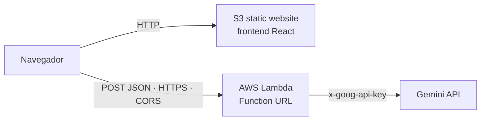

# Coding Bootcamp ESPOL — Laboratorio de Integración de IA

Aplicación que convierte un objetivo de aprendizaje en un plan de tareas generado con Gemini. Frontend en React + Vite, API en Node.js y despliegue automático en AWS con GitHub Actions. Identidad tipográfica educativa de Coding Bootcamp ESPOL (no contiene el logotipo institucional oficial).

- **Sitio publicado:** http://aws-bucket-ai-taller4.s3-website-us-east-1.amazonaws.com/
- **API pública (AWS Lambda):** `<URL de tu Lambda>` (se configura en la variable `API_URL` del repositorio)

---

## 1. Instalación

### Requisitos
- **Node.js LTS**: 22 o 24 recomendado. Vite 7 exige como mínimo 20.19. El pipeline usa Node 24.
- **npm**: incluido con Node.js.
- Una **clave de Gemini API**, solo si vas a ejecutar el backend local.

### Backend (API local)
```bash
cd backend
npm install
cp .env.example .env        # En Windows PowerShell: Copy-Item .env.example .env
# Edita .env y escribe tu GEMINI_API_KEY
npm run dev                 # API en http://localhost:3001
npm test                    # Pruebas del contrato y de la validación del objetivo (no llaman a Gemini)
```

### Frontend
En una segunda terminal:
```bash
cd frontend
npm install                 # o "npm ci" para instalar exactamente lo del package-lock.json
npm run dev                 # http://localhost:5173 (Vite reenvía /api al backend local)
npm run lint                # ESLint
npm run build               # Genera el sitio estático en frontend/dist
npm run preview             # Sirve frontend/dist en local para revisarlo
```

Para que el frontend local use la API publicada en lugar del backend local:
```bash
# macOS / Linux
VITE_API_URL="<URL de tu Lambda>" npm run dev
# Windows PowerShell
$env:VITE_API_URL="<URL de tu Lambda>"; npm run dev
```
> La Lambda solo acepta peticiones del navegador desde el origen del sitio en S3 (CORS). Desde `localhost` la petición se bloqueará, salvo que se agregue ese origen en `ALLOWED_ORIGIN`.

---

## 2. Configuración pública

Esta es la configuración que otra persona necesita para ejecutar o desplegar el proyecto. **Ninguna clave ni secreto está en el frontend ni en el repositorio.**

### Frontend (se incrusta en el JavaScript público)
| Variable | Valor | Uso |
|---|---|---|
| `VITE_API_URL` | `<URL de tu Lambda>` | URL del servicio de IA. Si no se define, se usa `/api/generate-tasks` (proxy de Vite al backend local). |

> Toda variable `VITE_*` termina visible en el bundle del navegador. Nunca debe contener claves.

### Variables del repositorio en GitHub (*Settings → Secrets and variables → Actions → Variables*)
| Variable | Uso |
|---|---|
| `API_URL` | Se pasa como `VITE_API_URL` al build del pipeline. |
| `AWS_REGION` | Región del bucket (`us-east-1`). |
| `S3_BUCKET_NAME` | Bucket de destino del despliegue. |

### Datos sensibles (solo se documentan los nombres, nunca los valores)
| Dónde | Nombre | Comentario |
|---|---|---|
| GitHub Secrets | `AWS_ACCESS_KEY_ID`, `AWS_SECRET_ACCESS_KEY`, `AWS_SESSION_TOKEN` | Credenciales para el job de despliegue. |
| Variables de entorno de la Lambda | `GEMINI_API_KEY` | Solo existe en AWS. |
| `backend/.env` (ignorado por git) | `GEMINI_API_KEY` | Solo para desarrollo local. Usa `backend/.env.example` como plantilla. |

### Configuración no sensible del backend
| Variable | Dónde | Ejemplo |
|---|---|---|
| `GEMINI_MODEL` | `backend/.env` y Lambda | `gemini-3.5-flash` (el modelo disponible puede variar por cuenta y fecha) |
| `PORT` | `backend/.env` | `3001` |
| `ALLOWED_ORIGIN` | Lambda | `http://aws-bucket-ai-taller4.s3-website-us-east-1.amazonaws.com` |

---

## 3. Arquitectura

| Capa | Tecnología | Ubicación |
|---|---|---|
| **Frontend** | React 18 + Vite 7 (SPA estática) | `frontend/` → publicado en Amazon S3 (static website hosting) |
| **Backend / API (producción)** | Node.js en **AWS Lambda** con Function URL | Se despliega manualmente desde la consola de AWS. Su código no está en este repositorio. |
| **Backend / API (local)** | Node.js + Express | `backend/server.js`, puerto 3001 |
| **Proveedor de IA** | **Google Gemini API** (`generateContent` con `responseMimeType` y `responseSchema`) | Se llama solo desde el backend. La clave nunca llega al navegador. |
| **Mock / simulador** | **No se usa.** | Todas las pruebas se hicieron contra Gemini real. Las pruebas de `npm test` validan las reglas sin llamar a la API. |



### Contrato de la API
`POST` con `{ "objective": "..." }`. El backend valida el objetivo (400 si no es válido), pide a Gemini un JSON estructurado y **valida cada tarea antes de responder**:
- `title` es un texto no vacío.
- `description` es texto.
- `priority` es `high`, `medium` o `low`.
- `estimatedMinutes` es un número mayor que 0.

Si la salida no cumple el contrato, responde **HTTP 502** con `{ "error": "..." }`. Si lo cumple, responde `{ "tasks": [...] }`. Más detalle en `docs/contrato-respuesta.md` y `docs/evaluacion-escenarios.md`.

### Del `git push` al sitio publicado (`.github/workflows/cicd.yml`)
1. **Disparador.**
   - Un Pull Request hacia `main` (`opened`, `synchronize`, `reopened`) ejecuta solo las validaciones.
   - Un `push` a `main` (merge del PR) ejecuta validaciones y despliegue.
   - `main` está protegida por un *ruleset*: exige PR, exige el check **Lint y build** en verde y bloquea los *force push*.
2. **Instalación.** El job `build` hace checkout, configura Node 24 con caché de npm y ejecuta `npm ci` en `frontend/`.
3. **Validación.** `npm run lint` (ESLint). Si falla, el pipeline se detiene.
4. **Build.** `npm run build` con `VITE_API_URL` tomado de `vars.API_URL`. Genera `frontend/dist`.
5. **Artifact.** `frontend/dist` se guarda como artefacto `frontend-dist` (retención de 14 días).
6. **Despliegue.** El job `deploy` corre solo si `build` tuvo éxito (`needs: build`) y si el evento es `push` a `main`. Descarga el artefacto, configura las credenciales de AWS desde los secrets y ejecuta `aws s3 sync dist/ s3://<bucket> --delete`.
7. **Hosting.** S3 sirve los archivos con *static website hosting* desde `us-east-1`.
8. **CDN.** **No hay CDN.** El sitio se sirve directamente desde el endpoint web de S3, sin CloudFront (ver Limitaciones).

---

## 4. Limitaciones

- **Solo HTTP.** El endpoint de sitio web de S3 no admite HTTPS. Para tener HTTPS y dominio propio hace falta otra capa: CloudFront con un certificado de ACM.
- **Sin CDN ni control de caché.** No hay CloudFront, así que no hay caché en el borde ni invalidaciones. El despliegue no define encabezados `Cache-Control`, y tras publicar puede hacer falta recargar con Ctrl+F5.
- **Credenciales temporales de AWS Academy.**
  - Las credenciales del laboratorio expiran al terminar la sesión. Mientras no se actualicen los tres secrets en GitHub, el despliegue falla con *"The security token included in the request is expired"*. Después de actualizarlos se usa *Re-run failed jobs*.
  - El laboratorio limita IAM, por lo que no se configuró un rol con OIDC, que evitaría guardar claves.
  - Los recursos dependen de que el laboratorio siga activo.
- **API pública sin autenticación.**
  - La Function URL usa `AuthType NONE` y no tiene límite de peticiones.
  - CORS solo restringe a los navegadores. Cualquier cliente HTTP (curl, scripts) puede llamarla y consumir la cuota de Gemini.
  - Para producción haría falta autenticación, *throttling* (API Gateway) o AWS WAF.
- **Backend fuera del pipeline.**
  - El código de la Lambda no está versionado en este repositorio y se despliega a mano.
  - Duplica la lógica de `backend/server.js`, así que un cambio en uno debe replicarse en el otro.
  - El pipeline solo valida y despliega el frontend. Las pruebas del backend (`npm test`) no corren en CI.
- **Tiempos de respuesta.**
  - Gemini puede tardar hasta unos 30 s. La Lambda tiene un timeout de 60 s y corta la llamada a Gemini a los 55 s.
  - Si se cambiara a API Gateway, su límite de unos 30 s podría cortar respuestas lentas.
- **Dependencia del proveedor de IA.** Los modelos de Gemini disponibles y las cuotas gratuitas cambian por cuenta y fecha. Si la API falla, hay que revisar `GEMINI_MODEL`.
- **Sin rollback automático.** Para volver a una versión anterior hay que revertir el cambio con un PR, que vuelve a desplegar. Los artefactos de build se conservan solo 14 días.
- **Avisos del pipeline.** Algunas acciones (`download-artifact@v4`, `configure-aws-credentials@v4`) generan avisos de deprecación de Node 20 en los runners de GitHub.
